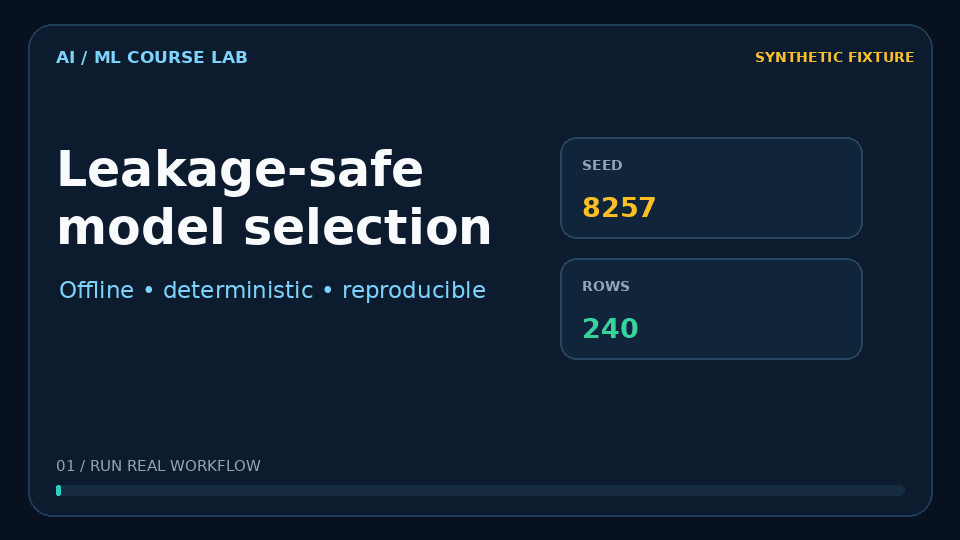

# AI & Machine Learning Course🧠📊


---

## Verified offline workflow

`ml_workflow.py` is the maintained, runnable course demonstration. It compares
four regression approaches on a deterministic **fictional fixture**, selects a
winner using training-only five-fold out-of-fold predictions, and evaluates
that winner once on a disjoint holdout:

```bash
python -m pip install -r requirements-course.txt
python ml_workflow.py --output artifacts/receipt.json
python -m pytest -q
```

The output is a reproducible workflow receipt, not a claim about real housing
prices, model accuracy in production, or deployment performance. Original exercise source is preserved byte-for-byte in `archive/`.



[Watch the MP4](docs/demo/model-selection-demo.mp4) ·
[Inspect the machine-readable workflow receipt](docs/demo/workflow-receipt.json) ·
[Verify capture provenance](docs/demo/capture.json)

---

## 🚀 Course Focus  
This course blends **core programming skills** with **AI/ML applications** for economic analysis, emphasizing:  
- **Python proficiency** for econometric modeling  
- **Machine learning pipelines** from data collection to deployment  
- **Ethical AI implementation** in economic research  

---

## 🔥 AI/ML Topics Intensive  

### **Core ML Foundations**  
1. **Supervised Learning**  
   - Linear/logistic regression (`statsmodels`, `sklearn`)  
   - Decision trees and ensemble methods (Random Forests, XGBoost)  
   - Model selection with cross-validation  

2. **Unsupervised Learning**  
   - Clustering (k-means, hierarchical)  
   - Dimensionality reduction (PCA)  

3. **Deep Learning Essentials**  
   - Neural networks for economic forecasting  
   - Natural language processing (NLP) for text-as-data  

### **AI for Economic Research**  
- **Automated Data Wrangling**: Web scraping (BeautifulSoup, Scrapy) + API integration  
- **Causal ML**: Double/debiased machine learning, causal forests  
- **AI Ethics**: Bias detection in economic models  

---

## 📚 Key Resources  
| Type | Resource |  
|------|----------|  
| Textbook | [Python Data Science Handbook](https://jakevdp.github.io/PythonDataScienceHandbook/) |  
| Textbook | [Introduction to Statistical Learning](https://www.statlearning.com/) |  
| Tool | [scikit-learn](https://scikit-learn.org/) |  
| Tool | [TensorFlow/Keras](https://www.tensorflow.org/) |  

---

## 💻 Technical Stack  
```python
# Example: Causal Forest for Heterogeneous Treatment Effects
from econml.forest import CausalForest
import pandas as pd

df = pd.read_csv("economic_data.csv")
cf = CausalForest(n_estimators=500)
cf.fit(X=df[features], T=df["treatment"], y=df["outcome"])
treatment_effects = cf.effect(df[features])
```

## Original regression exercises, repaired

`ml1.py` and `model_selection.py` now run all ten original linear, interaction,
quadratic, log-target, tree and forest candidates. They require an explicit
local CSV (`--csv path --target MEDV`) or an explicitly fictional offline
fixture. All preprocessing stays inside training folds, all log-model predictions
return to original target units, and the final holdout is never used to select
a winner. The old cross-transform BIC comparison is omitted because those
likelihoods were not comparable.

```bash
python ml1.py --fixture --output artifacts/ten-models.json
python model_selection.py --csv housing.csv --target MEDV --output artifacts/local-data.json
python crimeee.py --fixture --output artifacts/crime-regressions.json
python crimeee.py --csv london_crime.csv --output artifacts/london-regressions.json
```

The crime exercise fits its three original descriptive OLS specifications.
Year-over-year differences match **borough and week**, rather than subtracting
row positions; shuffled rows therefore produce identical results. Missing or
duplicate pairs, invalid logs and rank-deficient designs are errors. The redundant
`sixweeks` main effect is omitted because week fixed effects already span it.
The treatment interaction remains. Original London/Boston files are absent;
fixtures exercise calculations and do not reproduce those original studies or
identify causal effects. The GIF above continues to describe the separate,
unchanged four-model `ml_workflow.py` path.
